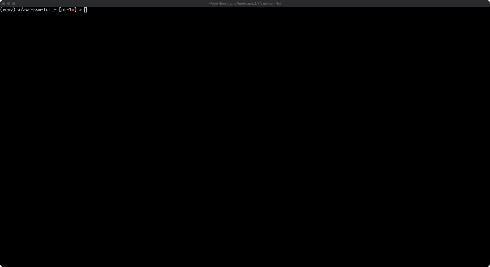

# AWS SSM Instance Browser TUI

A terminal user interface for browsing AWS SSM managed instances, switching AWS profiles, opening interactive Session Manager shells, and running port forwards in the background.



This project was built as part of the [Let's Get Rusty Accelerator](https://product.letsgetrusty.com/bootcamp-sp). Completing it was part of the requirement to graduate with [this certificate](https://brain.letsgetrusty.com/certificate/zyR1aOe_eeoFjMyh9NYJjFg6EuFHk5gY).

## Features

- Loads profiles from the standard AWS config files and shows region and SSO details (start URL, account, role).
- Detects a starting profile from `AWS_PROFILE`, then a profile named `default`, then the only profile when exactly one exists.
- Switching a profile rebuilds the SSM client with that profile name and updates `AWS_PROFILE`, then reloads instances.
- Lists managed instances from `DescribeInstanceInformation`, sorted by computer name. Columns: forward status, computer name, instance id, last ping, ping status, and platform name.
- Starts an interactive Session Manager shell on the selected instance. The TUI steps aside until the session ends, then comes back.
- Starts and stops a background port forward per instance (`AWS-StartPortForwardingSession`) without leaving the TUI. Active forwards show as `local→remote` in the FWD column.
- Surfaces port-forward failures and unexpected plugin exits in a scrollable console popup.
- Optional log panel (`tui-logger`) along the bottom of the screen.
- Keyboard only. Mouse capture stays off so terminal selection still works.

## Requirements

- Rust (edition 2021) and Cargo
- AWS credentials and profiles in the usual config files (`~/.aws/config` and `~/.aws/credentials`)
- [Session Manager plugin](https://docs.aws.amazon.com/systems-manager/latest/userguide/session-manager-working-with-install-plugin.html) (`session-manager-plugin`) on `PATH` for interactive sessions and port forwards
- Permission to call `ssm:DescribeInstanceInformation`, `ssm:StartSession`, and `ssm:TerminateSession` for the selected profile

## Run

```bash
cargo run
```

The crate name is `aws-ssm-tui`. The app opens on the profile screen.

## Controls

### Profile screen

| Key | Action |
|-----|--------|
| ↑ / ↓ | Move through profiles (wraps) |
| Enter | Activate the highlighted profile and reload instances |
| i | Open the instances screen |
| l | Toggle the log panel |
| q / Esc | Quit |

The list marks the active profile with `*`. The pane on the right shows region and SSO fields for the highlighted profile.

### Instances screen

| Key | Action |
|-----|--------|
| ↑ / ↓ | Move through instances (wraps) |
| s | Start an interactive Session Manager shell on the selected instance |
| f | Start a port forward, or stop the one already running for that instance |
| r | Reload instances for the active profile |
| p | Return to the profile screen |
| l / L | Toggle the log panel |
| q / Esc | Quit (active port forwards are stopped) |

### Port-forward dialog

`f` on an instance with no forward opens the start dialog. Defaults are remote port `22` and local port `2222`.

| Key | Action |
|-----|--------|
| Tab / ↑ / ↓ | Move between fields and buttons |
| Digits / Backspace | Edit the focused port |
| Enter | Confirm the focused field, or start the forward from OK |
| Esc | Cancel |

`f` on an instance that already has a forward opens a stop confirmation (OK / Cancel).

While a forward is starting, the FWD column shows `…`. One forward is kept per instance. The TUI stays up; plugin output is captured and shown if the process fails or exits.

### Console popup

Shown when a port forward fails or its plugin process exits.

| Key | Action |
|-----|--------|
| ↑ / ↓ or Page Up / Page Down | Scroll |
| Esc / Enter / q | Close |

## How it works

1. On startup, detect a profile and load every profile from the AWS config files. The SSM client is built with `aws_config` for that profile. The profile screen is shown first. The instance list is empty until a profile is activated or the list is refreshed.
2. Enter on a profile queues a switch. The event loop loads a new config with `.profile_name(...)`, replaces the SSM client, sets `AWS_PROFILE`, and calls `DescribeInstanceInformation`.
3. `i` opens the instance table. `r` reloads it for the client already in use.
4. `s` calls `StartSession`, leaves the alternate screen, and runs `session-manager-plugin` with the terminal attached. When the plugin exits, the TUI is restored.
5. `f` calls `StartSession` with `AWS-StartPortForwardingSession` and runs the plugin in the background. Stdout and stderr are captured. Stopping the forward kills the plugin and calls `TerminateSession`.

## Project structure

```
aws-ssm-tui/
├── Cargo.toml
├── Cargo.lock
└── src/
    ├── main.rs                  # Terminal setup and app entry
    ├── aws.rs                   # AWS module root
    ├── aws/
    │   ├── profile.rs
    │   ├── profile/
    │   │   ├── default.rs       # Detect AWS_PROFILE / default profile
    │   │   └── list.rs          # Load profiles from AWS config files
    │   └── ssm.rs               # Instance list, interactive sessions, port forwards
    ├── ui.rs
    ├── ui/
    │   ├── screen.rs            # Screen trait
    │   ├── profile.rs           # Profile selection screen
    │   ├── ssm.rs               # App state and event loop
    │   ├── ssm_instances.rs     # Instance table and port-forward dialogs
    │   └── logger.rs            # Bottom log panel
    ├── utils.rs                 # Shared helpers module
    └── utils/
        └── constants.rs         # AWS_PROFILE env var name
```
